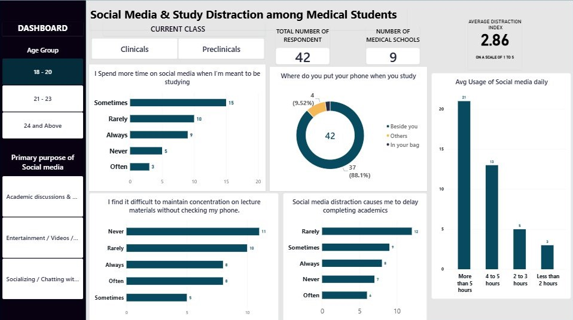
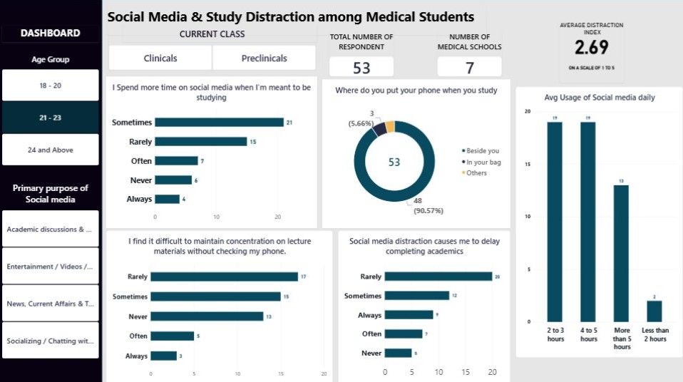

# Social Media Use and Study Distraction: An End-to-End Analysis

An end-to-end analysis of how social media use affects study focus among medical students: survey design and data collection, data cleaning in Power Query, a custom Distraction Index, statistical analysis, and an interactive Power BI dashboard.


## Key numbers

| Metric | Result |
|---|---|
| Respondents (after cleaning) | 98 medical students |
| Institutions | 13 |
| Average Distraction Index (1 to 5) | 2.74 |
| Students using social media 4+ hours a day | 70% |
| Students using it more than 5 hours a day | 38% |
| Students with high distraction (index 3.5 or above) | 27% |
| Keep their phone beside them while studying | 90% |

## Background and objectives

Medical students carry a heavy study load, and phones are within reach almost all the time. This project asks:

1. How much time do medical students spend on social media, and what do they use it for?
2. How often does social media interfere with studying (focus, assignments, lectures)?
3. Does distraction rise with more hours online?
4. Does distraction differ by age group, academic level or main purpose of use?

## Repository structure

```
├── README.md
├── data/
│   ├── social media study1.csv   Cleaned dataset (no emails)
│   └── data_dictionary.md                Every column explained
├── analysis/
│   └── cleaning_log.md                   Before/after record of every cleaning step
├── dashboard/
│   ├── SOCIAL_MEDIA_STUDY.pbix           Power BI report
│   └── screenshots/                      Overview and one image per slicer view
└── report/
    └── findings_report.pdf               Full written report
```

## Data

- **Source:** an anonymous online survey of undergraduate MBBS students, collected from 30 October to 4 November 2026.
- **Size:** 100 submissions, reduced to 98 usable responses after cleaning, covering 13 institutions.
- **Questions:** age, institution, academic level, phone type, daily hours on social media, time of day of heaviest use, main purpose of use, where the phone sits during study, and four statements about study distraction (rated Never to Always).
- **Privacy:** the raw file contained email addresses. They are not included in this repository.

## Data cleaning (Power Query)

Full detail is in [`analysis/cleaning_log.md`](analysis/cleaning_log.md). In summary:

| Issue in the raw data | What was done |
|---|---|
| 2 blank submissions (a test entry and an empty row) | Removed (100 to 98 rows) |
| Timestamp, screening and consent questions, and email columns | Removed from the analysis file |
| Age typed freehand ("20 years", "21+", "00", blanks) | Grouped into 18 - 20, 21 - 23 and 24 and Above |
| 28 spellings and acronyms for institutions (for example BAMUMSA, Bmu, Unilorin) | Standardised to 13 institution names |
| Academic level recorded as 200 to 600 | Grouped into Preclinicals (200 to 300L) and Clinicals (400L and above) |
| 9 phone labels (Tecno, Redmi, Itel, Oppo and others) | Grouped into Android, Iphone and Samsung |
| Distraction answers stored as numbers 1 to 5 | Converted to Never, Rarely, Sometimes, Often, Always |

## Method

**Distraction Index.** Four survey statements measure how social media interferes with study:

1. I lose focus during study sessions because I check social media notifications.
2. I spend more time scrolling than intended when I am supposed to be studying.
3. Social media distraction causes me to delay completing assignments or reading notes.
4. I find it difficult to maintain concentration on lecture materials without checking my phone.

Each answer is scored Never = 1, Rarely = 2, Sometimes = 3, Often = 4, Always = 5. A respondent's index is the average of their four scores (1 = never distracted, 5 = always distracted). Scores of 3.5 and above are labelled high distraction. The four items are internally consistent (Cronbach's alpha = 0.85).

**Analysis.** Descriptive statistics and group comparisons by hours of use, age group, academic level and purpose of use. The link between hours and the index was tested with a Spearman correlation.

**Tools.** Excel, Power Query, Power BI, DAX, Python (statistical tests).

## Key findings

- **Heavy use is the norm.** 70% spend four or more hours a day on social media, and only 5% spend under two.
- **More hours, more distraction.** The index rises from 1.70 (under 2 hours) to 2.39, 2.67 and 3.18 (over 5 hours). The relationship is moderate and statistically clear (Spearman rho = 0.36, p < 0.001).
- **Entertainment drives use.** 64% use social media mainly for videos and reels; 19% for socialising; 9% for academic discussion; 7% for news. Socialisers are the least distracted group (2.29).
- **Delaying work is the biggest problem.** 32% often or always delay assignments or reading because of social media, compared with 24% who scroll longer than intended and 25% who struggle to concentrate in lectures.
- **Phones stay within reach.** 90% keep the phone beside them while studying.
- **Late-night scrollers are the most distracted large group.** The index is 3.10 for midnight users (n = 12).
- **Academic level makes little difference.** Clinicals score 2.75 and preclinicals 2.72.
- **Younger students score slightly higher.** 18 - 20 year olds average 2.86 and 21 - 23 year olds 2.69.

## Dashboard

The Power BI report has slicers for age group, academic level and primary purpose, with charts for daily hours, phone location and the distraction statements.




To explore it, download `dashboard/SOCIAL_MEDIA_STUDY.pbix` and open it in Power BI Desktop (free, Windows).

## Limitations

- **Self-reported, cross-sectional data.** Results show associations, not cause and effect.
- **Convenience sample.** Three schools (Bayelsa Medical University, University of Ilorin and Benson Idahosa University) make up 87% of responses, so results may not represent all medical students.
- **Missing ages.** Ten respondents gave no valid age and are counted in the 21 - 23 group, so age comparisons involving that group should be read with care.
- **Small subgroups.** Ages 24 and above (n = 3), phones kept in a bag (n = 4) and morning scrollers (n = 2) are too small to interpret.
- **Phone categories.** Samsung phones run Android but are a separate category from Android, so brand comparisons are unreliable.
- **Hours are banded.** The survey has no option between "2 to 3 hours" and "4 to 5 hours".

## Ethics

Responses were collected anonymously. Email addresses were removed before analysis and are not published.

## Author

**Abdulakeem Olajide Jimoh**: medical student and data analyst.
[LinkedIn](https://www.linkedin.com/in/abdulakeem-jimoh) | [GitHub](https://github.com/JYDE01)

## License

MIT
